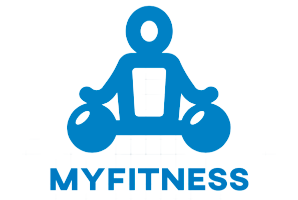

# Iron Lab &mdash; Comprehensive Fitness, Workouts & Nutrition Hub



> **Forging Strength, Fueling Health** &mdash; An all-in-one web-based fitness companion offering structured workout routines, comprehensive yoga instruction, specialized exercise categories, interactive health calculators, and customized dietary guidance.

---

## 📌 Table of Contents

- [Overview](#overview)
- [Key Features & Modules](#key-features--modules)
  - [1. Workout & Exercise Programs](#1-workout--exercise-programs)
  - [2. Yoga & Mindfulness Studio](#2-yoga--mindfulness-studio)
  - [3. Interactive Health & Fitness Calculators](#3-interactive-health--fitness-calculators)
  - [4. Diet & Nutrition Planner](#4-diet--nutrition-planner)
  - [5. Interactive FAQ & Knowledge Base](#5-interactive-faq--knowledge-base)
  - [6. Contact & Support Center](#6-contact--support-center)
- [Contact Details & Alternative Channels](#contact-details--alternative-channels)
- [Project File Structure](#project-file-structure)
- [Technologies Used](#technologies-used)
- [Getting Started / Local Setup](#getting-started--local-setup)
- [Legal & Governance](#legal--governance)
- [Contributing](#contributing)

---

## 🏋️ Overview

**Iron Lab** is an interactive, responsive fitness and wellness web application designed to guide individuals of all fitness levels towards their physical and nutritional goals. Built purely with clean, performant HTML5, CSS3, and JavaScript, **Iron Lab** delivers an accessible, zero-bloat user experience that runs instantly across desktop, tablet, and mobile browsers.

Whether you are looking to build strength, master yoga asanas, assess your body mass index (BMI), calculate daily caloric requirements, or plan a nutrient-rich diet, Iron Lab provides all the tools and resources in one centralized place.

---

## ✨ Key Features & Modules

### 1. Workout & Exercise Programs
- **Targeted Muscle Groups**:
  - **Abs Workouts**: Segregated into Beginner (`abs (beginner).html`), Intermediate (`abs(intermediate).html`), Advanced (`abs(advance).html`), and Complete Abs Overview (`abs(all).html`).
  - **Arms Workouts**: Progression levels for Beginner (`arms(beginner).html`), Intermediate (`arms(intermediate).html`), Advanced (`arms(advance).html`), and Master collection (`arms(all).html`).
  - **Shoulder Workouts**: Targeted routines for Beginner (`shoulder(beginner).html`), Intermediate (`shoulder(intermediate).html`), Advanced (`shoulder(advance).html`), and Shoulder Index (`shoulder(all).html`).
  - **Leg Workouts**: Dedicated routines spanning Beginner, Intermediate, Advanced, and Comprehensive Leg programs.
- **Cardio, Endurance & Sports Disciplines**:
  - Aerobic Conditioning (`aerobic-exersise.html`)
  - Anaerobic Training (`anaerobic-exersise.html`)
  - Outdoor & Indoor Cycling (`cycling.html`, `indoor-cycling.html`)
  - Running & Jogging Guidance (`running.html`)
  - Swimming Workouts (`swimming.html`)
  - Rowing Technique & Training (`rowing.html`)
  - Skating Performance (`skating.html`)
  - Weightlifting & Powerlifting Fundamentals (`weightlifting.html`)
  - Calisthenics & Pushups (`pushups.html`)
  - Jump Rope Conditioning (`jumprope.html`)
  - Isometric Holds & Strength (`isometrices.html`)
- **Video & Animation Demonstrations**: Embedded video clips demonstrating proper technique for crunches, burpees, bicycle kicks, arm rotations, triceps extensions, wall sits, and upper-body planks.

### 2. Yoga & Mindfulness Studio
- **Historical & Philosophical Foundations**: Detailed yogic principles covering Vedic roots, the Classical Yoga Period, Patanjali's Yoga-Sutras (the Eight-Limbed Path), and Post-Classical practices (`yoga.html`).
- **Tiered Asana Instruction**:
  - Yoga Beginner Series (`yoga beginner.html`)
  - Yoga Intermediate Series (`yoga intermediate.html`)
  - Yoga Advanced Series (`yoga advance.html`)
  - Yoga Master Collection (`yoga (all).html`)
- **Dedicated Asana & Pose Breakdowns**:
  - Animal Poses: Cat Pose (`cat(yoga).html`), Dog Pose (`dog.html`), Cobra Pose (`cobra(yoga).html`), Bird Pose (`birdpose.html`), Eagle Pose (`eagle.html`), Frog Pose (`frog.html`), Fish Pose (`fishpose.html`).
  - Foundational Poses: Mountain Pose (`mountainpose.html`, `mountain(intermediate).html`), Chair Pose (`chair.html`), Bow Pose (`bow.html`), Camel Pose (`camel.html`), Half Sitting (`halfsitting.html`), Garland Pose (`garland.html`), Gomukhasana (`gomukhasan.html`), Hero Pose (`hero.html`), Lord Pose (`lord.html`), Madhukasana (`madhukasan.html`).
  - Core & Inversion Poses: Plank (`plank(yoga).html`), Upplank (`upplank.html`), Side Plank (`sideplank.html`), Headstand (`headstand.html`), Sirsasana (`sirsashan(advance).html`), Wheel Pose (`wheel.html`), Superman Pose (`superman.html`), Wide-Angle Forward Bend (`wideangle.html`), V-Pose (`vpose.html`), Butt Bridge (`buttbridge.html`).
  - Breathwork (Pranayama): Alternate Nostril Breathing / Nadi Shodhana (`nadi.html`), Fundamental Pranayama (`pranayam.html`), and Advanced Breathwork (`pranayam(advance).html`).

### 3. Interactive Health & Fitness Calculators
- **BMI (Body Mass Index) Calculator** (`bmi.html`): Computes body mass index in real-time from user height and weight, categorizing results into Underweight, Normal, Overweight, or Obese categories.
- **Calorie Calculator** (`calorie calculator.html`): Implements validated metabolic equations taking into account gender, age, weight, and height to estimate resting and active daily caloric needs.
- **Diet Calculator** (`dietcalculator.html`): Computes precise daily caloric and macronutrient targets tailored to weight-loss, maintenance, or muscle-building goals.

### 4. Diet & Nutrition Planner
- **Balanced Diet Guidance** (`plandiet.html`): Visual diet charts, food group distributions (proteins, healthy fats, complex carbs, micronutrients), hydration strategies, and meal planning tips to complement exercise programs.

### 5. Interactive FAQ & Knowledge Base
- **FAQ Page** (`FAQ.html`): Interactive accordion-style FAQ covering workout frequency, fat loss mechanisms, strength training weight selection, yoga philosophies, and recovery strategies.

### 6. Contact & Support Center
- **Contact Page** (`contact.html`): Modern, responsive contact portal featuring:
  - Both primary and alternative email addresses, phone lines, and physical studio locations.
  - Interactive multi-field feedback & inquiry form with instant submission acknowledgment and reference tracking code.
  - Quick-navigation cards linking to FAQ, Calculators, and Diet plans.

---

## 📞 Contact Details & Alternative Channels

Iron Lab provides multiple verified primary and alternative communication channels to ensure inquiries, customer support, and partnership requests are handled promptly:

| Channel | Primary Detail | Alternative Detail / Hotline |
| :--- | :--- | :--- |
| **Email Support** | [`contact@ironlab.com`](mailto:contact@ironlab.com) | [`support@ironlab.com`](mailto:support@ironlab.com) &bull; [`ironlab.fitness@gmail.com`](mailto:ironlab.fitness@gmail.com) |
| **Telephone** | **+1 (800) 555-IRON** (+1 800-555-4766) | **+1 (555) 019-4766** &bull; Direct Member Desk: +1 (212) 555-0142 |
| **Headquarters** | **Iron Lab Performance Center**<br>100 Iron Works Way, Suite 400<br>New York, NY 10001, USA | **Iron Lab West Coast Studio**<br>450 Athletic Blvd, Suite 210<br>Los Angeles, CA 90015, USA |
| **Operating Hours** | Mon &ndash; Fri: 5:00 AM &ndash; 11:00 PM EST | Sat &ndash; Sun: 7:00 AM &ndash; 9:00 PM EST (Online Portal: 24/7) |
| **Online Helpdesk** | [Iron Lab Contact Portal](contact.html) | [Iron Lab Knowledge Base (FAQ)](FAQ.html) |

---

## 📂 Project File Structure

```text
Iron-Lab/
├── index.html                      # Homepage: hero showcase, navigation sidebar & footer
├── contact.html                    # Contact & Support page with alternative details & form
├── exersisemain.html               # Main Exercise landing hub (Aerobic & Anaerobic)
├── all workout.html                # Comprehensive workout index & muscle group directory
├── gym.html                        # Gym training guidelines & workout fundamentals
├── yoga.html                       # Yoga guide, history, philosophy, and pose directory
├── plandiet.html                   # Balanced diet charts, nutrition plans & guidance
├── FAQ.html                        # Interactive FAQ accordion page
│
├── [Health & Fitness Calculators]
│   ├── bmi.html                    # Body Mass Index (BMI) calculator
│   ├── calorie calculator.html     # Basal & daily calorie expenditure calculator
│   └── dietcalculator.html         # Custom diet and macronutrient calculator
│
├── [Targeted Muscle Workouts]
│   ├── abs (beginner).html         # Abs workout: Beginner
│   ├── abs(intermediate).html      # Abs workout: Intermediate
│   ├── abs(advance).html           # Abs workout: Advanced
│   ├── abs(all).html               # Abs workout: Complete collection
│   ├── arms(beginner).html        # Arms workout: Beginner
│   ├── arms(intermediate).html     # Arms workout: Intermediate
│   ├── arms(advance).html          # Arms workout: Advanced
│   ├── arms(all).html              # Arms workout: Complete collection
│   ├── shoulder(beginner).html     # Shoulder workout: Beginner
│   ├── shoulder(intermediate).html # Shoulder workout: Intermediate
│   ├── shoulder(advance).html      # Shoulder workout: Advanced
│   ├── shoulder(all).html          # Shoulder workout: Complete collection
│   ├── legs(beginner).html         # Leg workout: Beginner
│   ├── legs(intermediate).html     # Leg workout: Intermediate
│   ├── legs(advance).html          # Leg workout: Advanced
│   └── legs(all).html              # Leg workout: Complete collection
│
├── [Cardio & Specialized Exercises]
│   ├── aerobic-exersise.html       # Aerobic respiration & endurance exercise
│   ├── anaerobic-exersise.html     # High-intensity anaerobic workouts
│   ├── cycling.html                # Road cycling training
│   ├── indoor-cycling.html         # Stationary spin & indoor cycling
│   ├── running.html                # Running, pacing, and walk-run intervals
│   ├── swimming.html               # Swimming styles & pool workouts
│   ├── rowing.html                 # Ergometer rowing & stroke training
│   ├── skating.html                # Roller & ice skating fitness
│   ├── weightlifting.html          # Free weights, barbells & dumbbells
│   ├── pushups.html                # Pushup progressions & chest strength
│   ├── jumprope.html               # Speed rope conditioning & agility
│   └── isometrices.html            # Static isometric muscle tension holds
│
├── [Yoga Poses & Pranayama]
│   ├── yoga beginner.html          # Beginner yoga sequences
│   ├── yoga intermediate.html      # Intermediate yoga sequences
│   ├── yoga advance.html           # Advanced yoga sequences
│   ├── yoga (all).html             # Complete yoga asana collection
│   ├── birdpose.html, bow.html, buttbridge.html, camel.html, cat(yoga).html, chair.html...
│   ├── dog.html, eagle.html, fishpose.html, gomukhasan.html, headstand.html, hero.html...
│   └── nadi.html, pranayam.html, pranayam(advance).html, wheel.html, wideangle.html...
│
├── [Legal & Governance]
│   ├── terms and conditions.html   # Terms of Service & legal agreement
│   ├── disclaimer.html             # Medical disclaimer & warranty terms (HTML)
│   ├── Disclaimer.md               # Medical disclaimer & warranty terms (Markdown)
│   └── CODE_OF_CONDUCT.md          # Community standards, safety rules & contact info
│
├── [Assets]
│   └── images/                     # Logos, background imagery, diagrams, and video clips
└── README.md                       # Complete repository documentation
```

---

## 💻 Technologies Used

- **HTML5**: Clean, accessible, semantic markup with optimized viewport meta tags for modern mobile and desktop browsers.
- **CSS3**: Responsive layouts using Flexbox, CSS Grid, media queries, CSS variables, parallax scrolling backgrounds, and smooth UI transitions.
- **Vanilla JavaScript**: Pure ECMAScript (no external framework overhead) driving the sidebar drawer, accordion widgets, calculation engines, and interactive forms.
- **Google Fonts**: Modern typography utilizing `Montserrat`, `Roboto`, and `Lato`.
- **Media Assets**: High-resolution photography and lightweight MP4 exercise demonstration loops stored locally.

---

## 🚀 Getting Started / Local Setup

No build tools, package managers, or server installations are strictly required. You can launch Iron Lab directly in your browser:

### Option 1: Direct File Launch
Simply double-click `index.html` or open it with your browser of choice (Chrome, Edge, Firefox, Safari).

### Option 2: Using VS Code Live Server
1. Open the project folder in **Visual Studio Code**.
2. Install the **Live Server** extension (by Ritwick Dey).
3. Right-click `index.html` and choose **"Open with Live Server"**.
4. The site will launch automatically at `http://127.0.0.1:5500/index.html`.

### Option 3: Python Built-in HTTP Server
Run the following in your terminal or PowerShell from the project root:
```bash
python -m http.server 8000
```
Then navigate to `http://localhost:8000` in your browser.

---

## ⚖️ Legal & Governance

- **Terms and Conditions**: Full user terms, intellectual property protections, service limitations, and dispute resolution guidelines are detailed in [`terms and conditions.html`](terms%20and%20conditions.html).
- **Medical Disclaimer**: Exercise and nutritional information is provided for general educational purposes and does not substitute for certified medical advice. Read [`disclaimer.html`](disclaimer.html) or [`Disclaimer.md`](Disclaimer.md).
- **Community Code of Conduct**: All participants and contributors are expected to uphold respectful, inclusive behavior as outlined in [`CODE_OF_CONDUCT.md`](CODE_OF_CONDUCT.md).

---

## 🤝 Contributing

Contributions to Iron Lab are warmly welcomed! If you wish to suggest workout improvements, add yoga poses, or report a bug:
1. Fork the repository.
2. Create your feature branch (`git checkout -b feature/NewWorkoutFeature`).
3. Commit your changes (`git commit -m 'Add new workout routine'`).
4. Push to the branch (`git push origin feature/NewWorkoutFeature`).
5. Open a Pull Request.

For direct feedback, inquiries, or community reports, email us anytime at [`contact@ironlab.com`](mailto:contact@ironlab.com) or [`support@ironlab.com`](mailto:support@ironlab.com).

---

<p align="center">
  <strong>Iron Lab &copy; 2026. All Rights Reserved.</strong><br>
  <em>Forging Strength, Fueling Health.</em>
</p>
